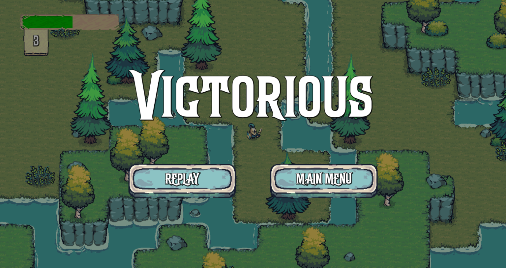
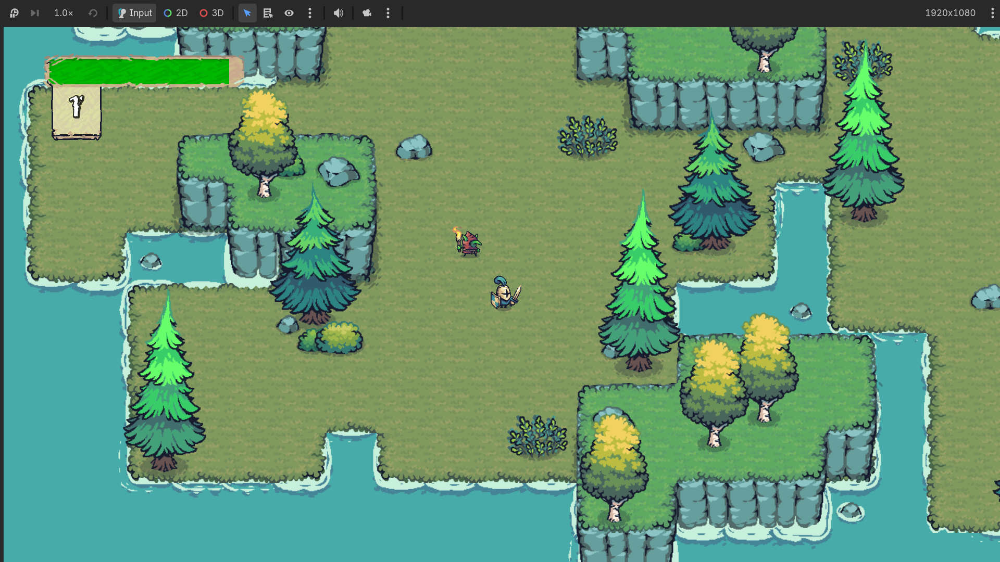
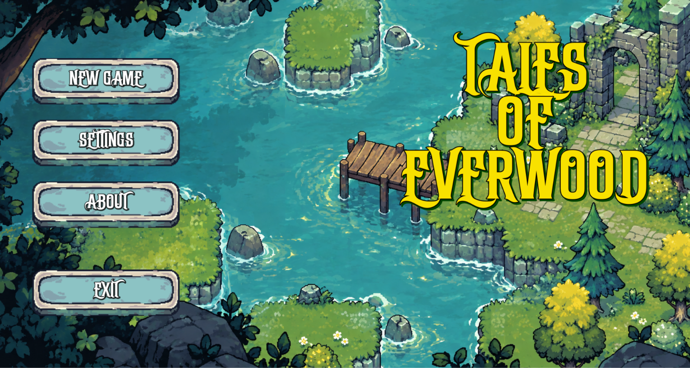

# Tales of Everwood

A colorful, pixel-art top-down RPG adventure developed using Godot and GDScript.

**Play online:** [Tales of Everwood on itch.io](https://renrun12.itch.io/tales-of-everwood)  
**Download for Windows:** [Get the Windows build](https://renrun12.itch.io/tales-of-everwood)

## 🎮 About

Tales of Everwood is a top-down fantasy adventure where the player controls a knight exploring a pixel-art world, fighting enemies, gaining experience, and becoming stronger.

The current release is a playable prototype featuring combat, enemy AI, XP progression, and victory and game-over systems. The project is planned to expand into a larger, story-driven RPG with multiple maps and areas.

## ✨ Features

- 🗡️ Top-down player movement and combat
- 👾 Enemy AI with chasing and attacking
- ❤️ Player health system
- ⚔️ Direction-based attacks
- ⭐ XP and level-up system
- ⚡ Attack speed upgrades through progression
- 🏆 Victory condition
- 💀 Game-over system
- 🔄 Replay functionality
- ⏸️ Pause functionality
- 🏠 Main menu and navigation
- ℹ️ About screen
- 🎨 Pixel-art fantasy environment

## 🛠️ Built With

- **Godot Engine 4**
- **GDScript**

## 🎨 Assets & Credits

This game uses assets from **Tiny Swords** by Pixel Frog.

- **Asset pack:** [Tiny Swords](https://pixelfrog-assets.itch.io/tiny-swords)
- **Creator:** Pixel Frog
- **Platform:** itch.io

All credit for the original Tiny Swords assets goes to Pixel Frog.

## 🎯 Current Version

**v1.0 — Playable Prototype**

The current release features a single playable area with enemies, combat, XP progression, victory and game-over systems, and supporting game menus.

Play the game directly in your browser or download the Windows build from [itch.io](https://renrun12.itch.io/tales-of-everwood).

## 📸 Screenshots

### Main Menu

### Gameplay

### Victory

## 🎮 Controls

| Action | Control |
|---|---|
| Move | WASD keys |
| Attack | Spacebar |

## 🚀 Future Plans

- Multiple story-driven maps
- New enemies and bosses
- More weapons and abilities
- NPCs and dialogue
- Quests and story progression
- Expanded world exploration
- Additional levels and environments

## 👨‍💻 Developer

**H N Adith**

Built as a personal game development project while learning and experimenting with Godot.

---

⭐ More features, maps, and content are planned as development continues.
